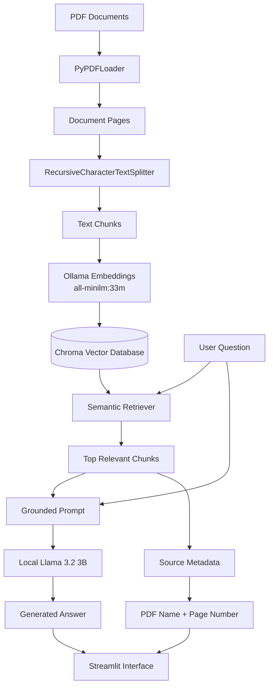
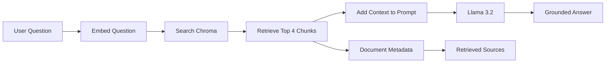
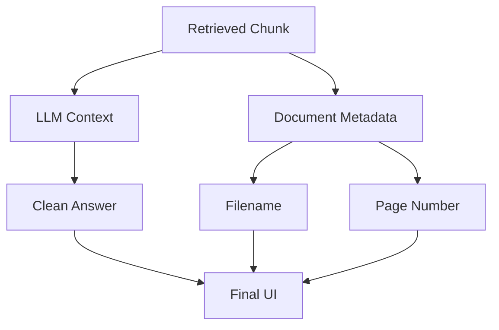

# 🧠 AI Course Intelligence

### Multi-Document Retrieval-Augmented Generation Chatbot

[](https://www.python.org/)
[](https://streamlit.io/)
[](https://www.langchain.com/)
[](https://ollama.com/)
[](https://www.trychroma.com/)
[](#)
[](#)

---

## 📌 Project Overview

**AI Course Intelligence** is a local multi-document Retrieval-Augmented Generation application developed to explore Artificial Intelligence and Large Language Model course materials.

The application searches across multiple PDF documents, retrieves the most relevant information, and sends only that context to a local Large Language Model.

The final answer is therefore grounded in the indexed documents instead of relying only on the model's internal knowledge.

The application also displays the retrieved document names and page numbers so users can inspect where the information came from.

---

## 👨‍💻 Developed By

**Ruturaj Mokashi**

AI Applications Project  
Day 6 — Multi-Document RAG Chatbot

---

## 🎯 Project Objective

The goal of this project was to extend a basic RAG pipeline into a complete multi-document AI assistant.

The final system can:

- search across multiple PDF documents
- split documents into searchable chunks
- convert text into vector embeddings
- store embeddings in Chroma
- retrieve relevant document sections
- generate grounded answers using a local LLM
- show document sources and page numbers
- reject questions that cannot be answered from the documents
- provide a professional Streamlit chat interface
- evaluate different RAG configurations

---

# 🏗️ System Architecture



---

# 🔎 RAG Workflow

The application follows the standard Retrieval-Augmented Generation process:



In simple words:

**Find → Add → Answer**

1. **Find** relevant information.
2. **Add** that information to the prompt.
3. **Answer** using the local language model.

---

# 📚 Knowledge Base

The final knowledge base contains:

| Metric | Value |
|---|---:|
| PDF documents | 5 |
| Total pages | 1,031 |
| Final chunks | 3,182 |
| Chunk size | 800 |
| Chunk overlap | 100 |
| Retrieval `k` | 4 |

The documents cover topics including:

- Large Language Models
- Prompt Engineering
- Hugging Face
- AI Agents
- Agentic Design Patterns
- LLM Applications

---

# 🧩 Document Processing

The original documents contained **1,031 pages**.

They were divided into smaller searchable text chunks using:

```python
RecursiveCharacterTextSplitter(
    chunk_size=800,
    chunk_overlap=100,
    add_start_index=True
)
```

This produced:

```text
1,031 Pages
      ↓
3,182 Chunks
```

Smaller chunks make it easier for the retrieval system to locate the specific information required for a question.

---

# 🧠 Embeddings

The project uses:

```text
all-minilm:33m
```

through Ollama.

Embeddings convert text into numerical vectors that represent semantic meaning.

Conceptually:

```text
"What is prompt engineering?"
            ↓
      Embedding Model
            ↓
   Numerical Vector
            ↓
Similarity Search
```

This allows the application to search based on **meaning**, not only exact keywords.

---

# 🗄️ Vector Database

The vector embeddings are stored using **Chroma**.

Chroma stores:

- text chunks
- embedding vectors
- source filename
- PDF page number
- document metadata

A persistent database is used so the documents do not need to be indexed every time the application starts.

---

# 🔍 Semantic Retrieval

The final retriever uses:

```python
retriever = vectorstore.as_retriever(
    search_type="similarity",
    search_kwargs={"k": 4}
)
```

This means the system retrieves the **4 most semantically relevant chunks** for each question.

---

# 🤖 Local Large Language Model

The application uses:

```text
Llama 3.2:3b
```

through Ollama.

The model runs locally instead of sending document content to an external LLM API.

This architecture provides:

- local processing
- privacy
- no LLM API cost
- offline experimentation
- control over the complete RAG pipeline

---

# 🛡️ Grounded Answer Generation

The LLM receives strict instructions to answer only from retrieved context.

If the information cannot be found, the chatbot responds:

> The answer is not available in the provided course materials.

This reduces hallucination risk.

---

# 📚 Source-Aware Answers

Source citations are **not generated by the LLM**.

Instead, filenames and page numbers are read directly from the metadata stored in Chroma.

This prevents the model from inventing page numbers.

Architecture:



The result is a clean separation between:

```text
LLM
↓
Generates Answer

Python / Chroma Metadata
↓
Generates Source Information
```

---

# 💬 Streamlit Application

The user interface was created using Streamlit.

The app includes:

- professional dashboard layout
- project branding
- developer name
- knowledge-base statistics
- AI technology stack
- switchable topic tabs
- suggested questions
- chat history
- custom questions
- retrieved document sources
- expandable retrieved context
- clear-conversation functionality

---

# 🧭 Topic Explorer

Users can explore dedicated topic sections:

### 🧠 Large Language Models

Learn how language models work and generate text.

### ✍️ Prompt Engineering

Explore effective prompts and model instructions.

### 🤖 AI Agents

Understand autonomous systems, tools and decision-making.

### 🔗 Hugging Face

Explore pretrained models and the Transformers ecosystem.

### ⚙️ Agentic Design Patterns

Understand common architectural patterns used to build AI agents.

### 📚 LLM Applications

Explore practical business and technical LLM use cases.

---

# 🧪 RAG Evaluation

Three configurations were evaluated.

| Configuration | Chunk Size | k | Correct Answers | Correct Document Sources | Hallucinations |
|---|---:|---:|---:|---:|---:|
| A | 400 | 4 | 10 / 10 | 8 / 8 | 0 |
| **B** | **800** | **4** | **10 / 10** | **8 / 8** | **0** |
| C | 800 | 8 | 8 / 10 | 8 / 8 | 0 |

---

# 🏆 Selected Configuration

The final chatbot uses:

```text
chunk_size = 800
chunk_overlap = 100
k = 4
```

This is **Configuration B**.

Although Configuration A achieved similar answer accuracy, it created:

```text
6,616 chunks
```

while Configuration B required only:

```text
3,182 chunks
```

Configuration B therefore achieved the same answer quality with a smaller vector database and less retrieval overhead.

Configuration C demonstrated another important RAG lesson.

Increasing:

```text
k = 4
```

to:

```text
k = 8
```

did not improve the system.

Instead, the additional chunks introduced irrelevant context and reduced answer quality for some questions.

---

# 💡 Key Learning

The project demonstrated an important RAG principle:

> **More context does not always produce better answers.**

A strong RAG system needs to balance:

```text
Relevant Context
       +
Enough Information
       -
Retrieval Noise
       =
Better Answers
```

---

# 🧪 Out-of-Document Testing

The chatbot was also tested with questions deliberately unrelated to the knowledge base.

Examples included questions about:

- Germany's population in 2025
- the 2022 FIFA World Cup winner

The chatbot correctly refused to answer from unsupported information.

Example response:

```text
The answer is not available in the provided course materials.
```

This verifies that the grounding mechanism is functioning correctly.

---

# ⚙️ Technology Stack

| Technology | Purpose |
|---|---|
| Python | Core development |
| Streamlit | Web application |
| LangChain | RAG orchestration |
| Ollama | Local AI runtime |
| Llama 3.2:3b | Language model |
| all-minilm:33m | Embedding model |
| Chroma | Vector database |
| PyPDF | PDF extraction |
| Pandas | Evaluation and analysis |
| Jupyter | Development and experiments |

---

# 📂 Project Structure

```text
AI-Course-Intelligence/
│
├── app.py
│
├── Day6_Project3_Course_Chatbot.ipynb
│
├── README.md
│
├── requirements.txt
│
└── .gitignore
```

Local files that are intentionally excluded from GitHub:

```text
chroma_day6/
chroma_day6_config_A/
course PDFs
virtual environments
Streamlit secrets
```

---

# 🚀 Local Installation

## 1. Clone the repository

```bash
git clone <your-repository-url>
```

Move into the project:

```bash
cd <repository-name>
```

---

## 2. Create a Python environment

Example using Conda:

```bash
conda create -n llm_env python=3.11
```

Activate it:

```bash
conda activate llm_env
```

---

## 3. Install dependencies

```bash
pip install -r requirements.txt
```

---

## 4. Install Ollama

Install Ollama from:

https://ollama.com/

Then download the required models:

```bash
ollama pull llama3.2:3b
```

```bash
ollama pull all-minilm:33m
```

---

## 5. Start Ollama

```bash
ollama serve
```

---

## 6. Run the Streamlit application

```bash
streamlit run app.py
```

Then open:

```text
http://localhost:8501
```

---

# ⚠️ Deployment Note

The current version uses **local Ollama models**.

Therefore:

```text
Ollama
↓
runs on localhost
↓
works locally
```

A public cloud deployment requires replacing or hosting the local Ollama inference layer on infrastructure accessible to the deployed application.

The Streamlit interface and RAG architecture are deployment-ready, but the LLM and embedding backend must be adapted for cloud hosting.

---

# 🔐 Privacy

The local version keeps document processing and LLM inference on the user's own machine.

No course-document text needs to be sent to an external LLM provider.

---

# 📈 Future Improvements

Possible extensions include:

- conversational follow-up questions
- query rewriting
- hybrid retrieval
- BM25 + vector search
- reranking
- document upload
- automatic document indexing
- similarity scores
- LLM-as-a-Judge evaluation
- cloud-hosted inference
- user authentication
- additional document collections

---

# 🎓 Learning Outcome

This project demonstrates an end-to-end understanding of:

```text
Document Loading
      ↓
Chunking
      ↓
Embeddings
      ↓
Vector Storage
      ↓
Semantic Retrieval
      ↓
Prompt Grounding
      ↓
Local LLM
      ↓
Source-Aware Answers
      ↓
RAG Evaluation
      ↓
Streamlit Application
```

It combines concepts from:

- Large Language Models
- Retrieval-Augmented Generation
- LangChain
- Ollama
- Vector databases
- prompt engineering
- AI application development
- model evaluation
- user-interface development

---

## 👨‍💻 Author

**Ruturaj Mokashi**

Data Analytics · AI Applications · Machine Learning · Business Intelligence

---

## ⭐ Project Status

```text
Multi-Document Loading       ✅
Chunking                     ✅
Embeddings                   ✅
Persistent Vector Database   ✅
RAG Retrieval                ✅
Grounded Generation          ✅
Source Attribution           ✅
Streamlit Interface          ✅
Configuration Evaluation     ✅
Local Application            ✅
Cloud Deployment             🔄
```